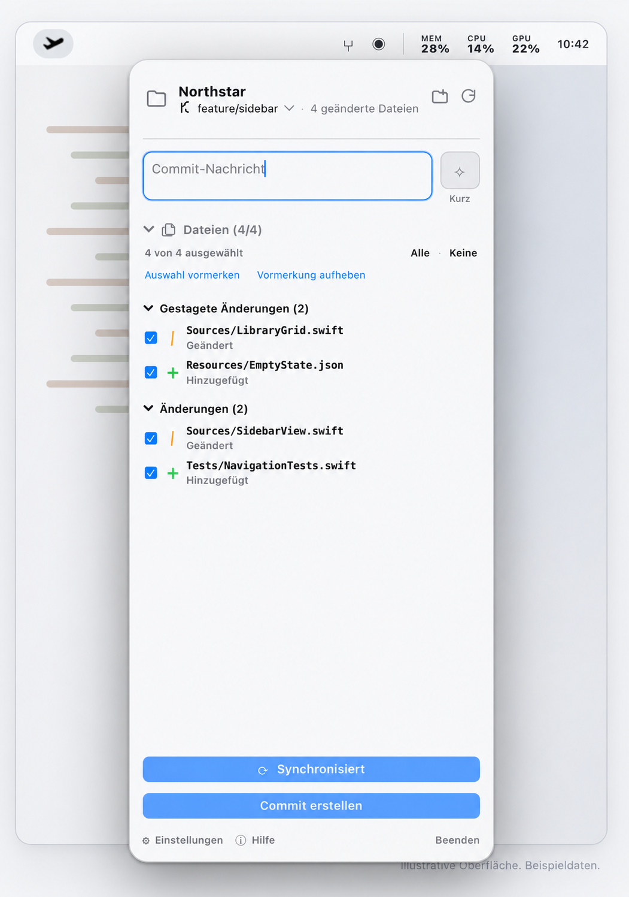

# CommitJet

A small native macOS menu bar helper for making local Git commits. CommitJet can ask a local Ollama server to suggest a commit subject, but manual commits work without Ollama.

## App preview

<p align="center">
  
</p>

<p align="center"><em>Illustrative interface with sample data, matching the product page.</em></p>

## Product page

The static product page lives in `docs/` and is ready for GitHub Pages. It is available in German and English, with the visitor's language choice saved in the browser. In the repository settings, choose **Settings → Pages → GitHub Actions** as the build and deployment source. The workflow in `.github/workflows/pages.yml` publishes updates from `main` whenever `docs/` changes. After the first successful deployment, the page will be available at <https://dmo-code.github.io/CommitJet/>. The page uses a mock app preview to illustrate the interface; its sample repository and commit text are illustrative.

## Requirements

- macOS 13 or later
- Xcode 27.2 or a compatible recent Xcode with Swift 6
- Git available at `/usr/bin/git`
- Ollama is optional; the default server is `http://localhost:11434`

The app uses SwiftUI `MenuBarExtra` with the native window style and has no Dock icon or persistent main window. The deployment target is macOS 13.

## Build and run

1. Open `CommitJet.xcodeproj` in Xcode.
2. Select the **CommitJet** scheme and run it, or build with:

   ```sh
   xcodebuild -project CommitJet.xcodeproj -scheme CommitJet -destination 'platform=macOS' -derivedDataPath /tmp/CommitJetDerived CODE_SIGNING_ALLOWED=NO build
   ```

The app appears in the menu bar. Choose a local Git repository to see its current branch, changed-file count, and an expandable, scrollable list of changed paths and statuses. Select files and use **Stage selected** or **Unstage selected** to manage the Git staging area. Commits and AI message suggestions use staged changes only. Select the branch name to search and switch between local branches. Git keeps compatible working-tree changes and blocks a switch if it would overwrite them. Enter a commit message, then select **Commit**. On the first commit in each repository, confirm that the staged changes should be committed. Select **Don't show again** in that warning to suppress it for future commits; you can restore it in Settings.

## Unsigned GitHub releases

CommitJet is distributed as an unsigned macOS app outside the App Store. No Apple Developer account is required for this release path. The app targets macOS 13 and later and is packaged for both Apple silicon and Intel Macs.

To build a release ZIP locally:

```sh
   ./scripts/package-release.sh 1.0.2
```

The script writes `CommitJet-1.0.2-macOS.zip` and its SHA-256 checksum under `.build/releases/`. To publish a GitHub Release, push a version tag after committing the release changes:

```sh
git tag v1.0.2
git push origin v1.0.2
```

Pushing a `v*` tag runs the GitHub Actions release workflow, which builds the unsigned app and attaches the ZIP and checksum to a GitHub Release.

CommitJet checks GitHub Releases for updates when Settings opens. If a newer version is available, Settings shows its release notes and can download the macOS ZIP with a visible progress indicator. Before saving the ZIP to Downloads, CommitJet verifies it against the release's SHA-256 checksum. Open the downloaded ZIP and move `CommitJet.app` to Applications to replace the installed version.

### Opening the downloaded app

Because CommitJet is not signed or notarized, macOS may say that Apple cannot check it for malicious software. If you downloaded CommitJet from the official [GitHub Releases page](https://github.com/dmo-code/CommitJet/releases) and want to open it:

1. Double-click the downloaded ZIP to extract `CommitJet.app`, then move the app to your **Applications** folder.
2. Try to open CommitJet once. When macOS shows the warning, click **Done**; do not choose **Move to Trash**.
3. Open **Apple menu → System Settings → Privacy & Security** and scroll down to the **Security** section.
4. Click **Open Anyway** (German: **Dennoch öffnen**) next to the message about CommitJet.
5. Confirm the warning that appears again by clicking **Open**. Enter your Mac password if requested.

After you approve it this way, you can open CommitJet normally. This approval is needed once on each Mac. See [Apple's guidance for opening apps](https://support.apple.com/en-us/102445).

To start CommitJet automatically when you sign in to your Mac, enable **Launch at login** in Settings. macOS may ask you to allow it under **System Settings → General → Login Items**.

## Ollama

Start Ollama locally, install a model (for example `ollama pull qwen2.5-coder`), then open CommitJet's Settings. Keep the server address at `http://localhost:11434`, load models, and select one. Choose English or German as the commit message language and select a short, normal, or detailed suggestion. Short generates one subject line of at most 50 characters; normal adds one body sentence of at most 20 words; detailed adds 2–3 body sentences of at most 45 words. The selected length is shown beside the Sparkles button and in the ready-to-review status. You can edit the suggestion before committing. In-app Help explains repository selection, message generation, privacy, and confirmation settings.

AI generation is optional and only runs after clicking Sparkles. A remote server address triggers a privacy notice; the diff is sent only to that configured endpoint. Requests have a 45 second timeout and diffs larger than 150 KB are refused.

## Privacy

CommitJet has no telemetry, accounts, or cloud integration. It does not upload Git data automatically. Repository content is not written to app logs. Git diff content is treated as untrusted prompt data and cannot trigger app actions.

## Git behavior and limitations

- CommitJet creates local commits, switches between existing local branches, and pushes commits to a configured remote when you select **Sync changes**. For a branch without an upstream, it publishes the branch to the first configured remote. If the local branch is behind its upstream, pushing is blocked and the remote changes must be pulled with another Git client first.
- A commit includes only staged changes. Stage selected files to add their current contents to the index, or unstage them to keep those changes out of the commit. The AI suggestion also uses only the staged diff.
- The first commit in each repository requires confirmation unless you suppress the warning. Changed submodules, unresolved conflicts, and active merge/rebase/cherry-pick/revert/bisect states are refused.
- Before committing, CommitJet checks that the staged diff still matches the analyzed AI diff.
- If Git reports errors (for example missing author identity), CommitJet shows the Git error. The app never changes Git configuration.
- CommitJet is not sandboxed so it can run the local Git CLI and access the repository selected by the user. Only local selected repository paths are passed to Git.

## Tests

Run the unit tests with:

```sh
xcodebuild -project CommitJet.xcodeproj -scheme CommitJet -destination 'platform=macOS' -derivedDataPath /tmp/CommitJetDerived test
```

Tests use disposable local repositories under the system temporary directory.

## License

MIT. See [LICENSE](LICENSE).

The name CommitJet is provisional and has not received trademark clearance. The app name and bundle identifier are defined in the Xcode project build settings and can be changed there.
